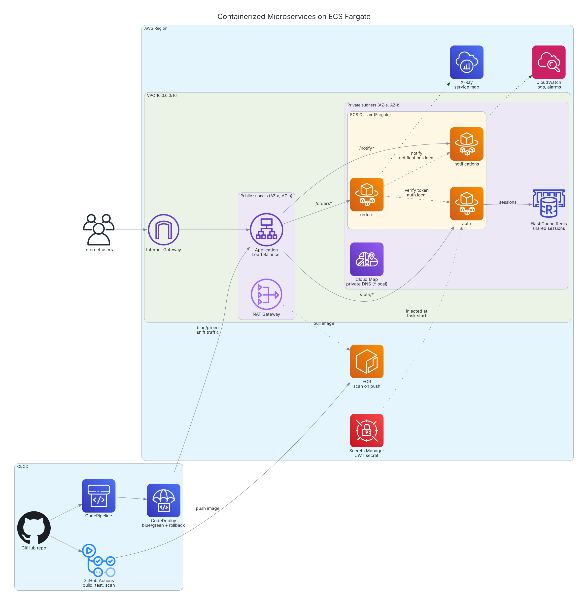

# Containerized Microservices on AWS ECS Fargate

A Node.js application split into three microservices (**Auth**, **Orders**, **Notifications**) running on Amazon ECS Fargate, with service discovery, secret injection, shared session caching and a blue/green CI/CD pipeline.

## Architecture

**How a request flows**

1. Users reach the Application Load Balancer through the Internet Gateway. The ALB sits in public subnets across two Availability Zones.
2. Path rules route traffic to the right service: `/auth/*`, `/orders*`, `/notify*`.
3. The services run on Fargate in private subnets and have no public IPs. Orders calls Auth and Notifications by Cloud Map DNS name (`auth.local`, `notifications.local`).
4. Auth keeps sessions in ElastiCache Redis, so any task can serve any request. The JWT secret comes from Secrets Manager at task start.
5. Images are built by GitHub Actions and pushed to ECR. CodeDeploy shifts ALB traffic from the blue to the green task set and rolls back automatically on failed health checks.
6. Container logs go to CloudWatch, and traces go to X-Ray.

| Component | AWS service | Purpose |
|---|---|---|
| Compute | ECS Fargate | Runs the three services with no servers to manage |
| Registry | ECR | Private images, scan on push |
| Ingress | ALB + target groups | Path routing: `/auth/*`, `/orders/*`, `/notify*` |
| Discovery | Cloud Map | Services reach each other by private DNS name |
| Secrets | Secrets Manager | JWT secret and credentials injected at runtime |
| Cache | ElastiCache Redis | Shared session store across stateless tasks |
| CI/CD | CodePipeline + CodeDeploy | Blue/green deploys with automatic rollback |
| Tracing | X-Ray | Service map across the three services |
| IaC | Terraform | Everything above defined as code |

## Services

| Service | Endpoints | Notes |
|---|---|---|
| auth | `POST /auth/login`, `POST /auth/verify`, `GET /health` | Issues JWTs, stores sessions in Redis |
| orders | `POST /orders`, `GET /orders`, `GET /health` | Verifies the caller through auth, triggers notifications |
| notifications | `POST /notify`, `GET /notifications`, `GET /health` | Records notifications, logs to stdout (CloudWatch) |

